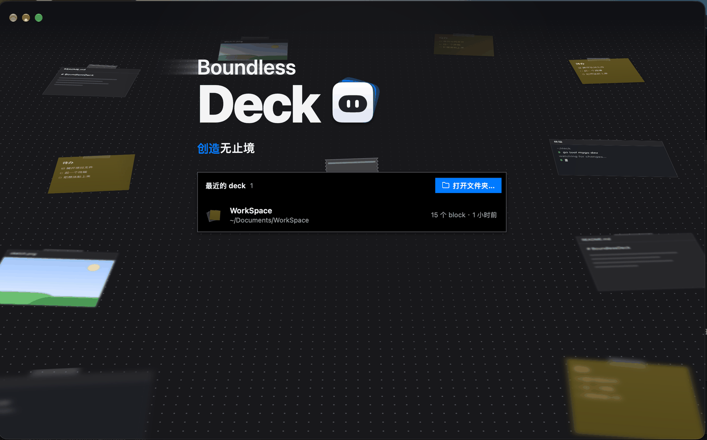
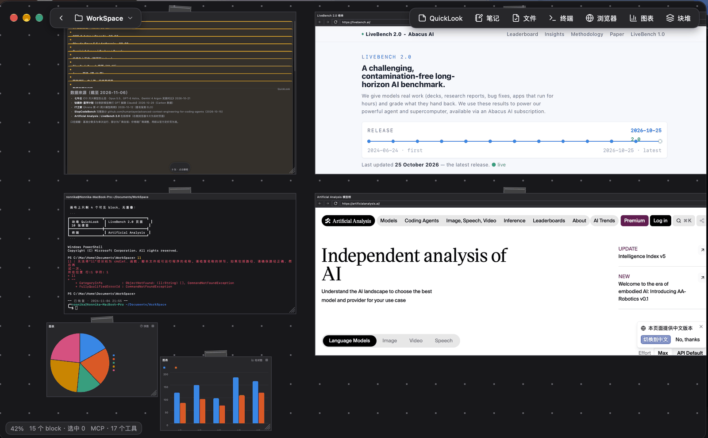

# BoundlessDeck



无限画布工作台，原生 UI。

画布上只有一种东西：**block**。便利贴、文件、终端、浏览器、笔记、块堆都只是 block 的不同 `kind`，不是面板、窗口或文档标签；遇到新能力先问它是 block 的字段还是 kind，两者都不成立才引入新的界面概念。反过来，`block` 每通用一分，数据、撤销、持久化、MCP 与 UI 就同时多一分能力，而且只有一条路径。

它同样是给 agent 干活的画布，而不是给人用、再顺手开个接口。所以打开一个 deck，它本身就是 MCP 端点，agent 与人共享同一条路径：同一个 `addBlock`/`removeBlock`、同一个撤销栈、同一个选择集、同一份 block 字段表、同一次保存。人能看见 agent 的每一步，也能 `⌘Z` 退回；UI 没有特权，agent 能改的就是人能改的，反过来也一样。内置 agent 还没做，但接口是按「agent 是第一用户」设计的。

三条主线需求：本地文件超链接与预览、代码嵌入、终端。需求与架构见 [docs/requirements.md](docs/requirements.md)。



## 运行

常用任务都在 `Makefile` 里，`make` 列出全部（`make dev`、`make build-windows`、`make check`……）。

```sh
go tool mygo dev ./app    # 开发模式，改 .go 自动重启
go tool mygo build ./app  # 打包到 build/<os>-<arch>/
```

macOS 13+（终端用 libghostty-vt）。

## 开发

```sh
go test ./...                                    # 画布与持久化的单测（无窗口）
go test -race ./...
go tool mygo vet ./app                           # 检查原生 UI 的构建期生命周期问题
DECK_SNAPSHOT=1 go test -run TestSnapshot ./app  # 重画 docs/canvas-snapshot.png
```